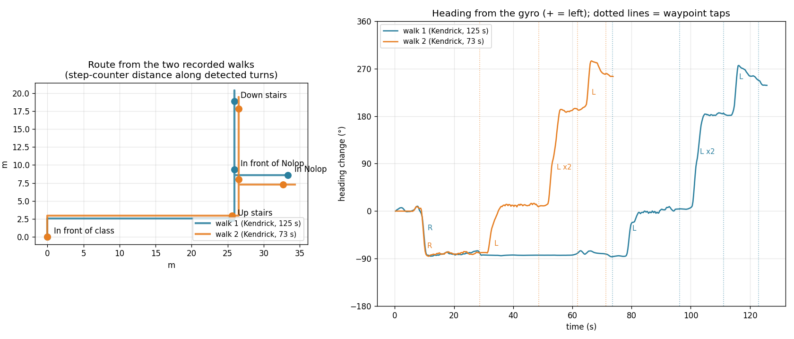
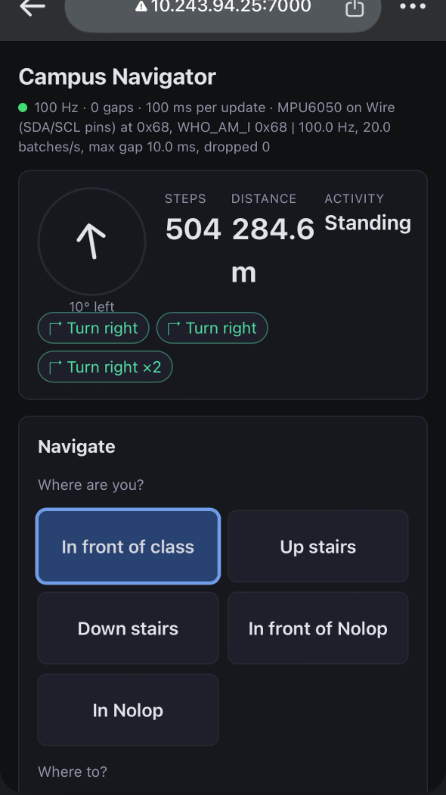
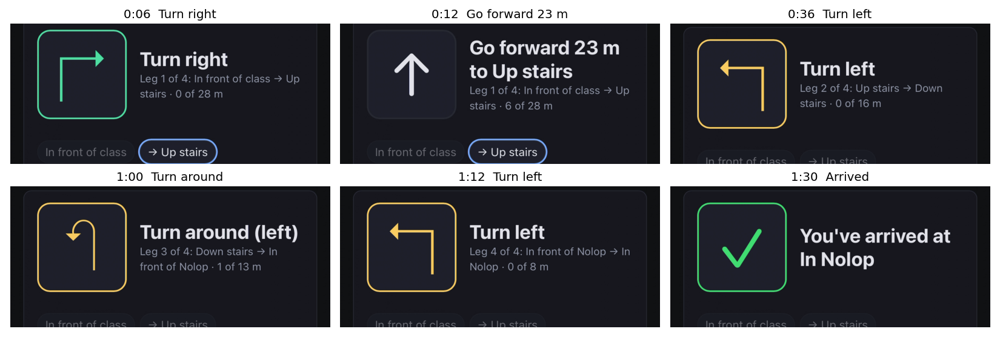

# 🧭 Campus Navigator

A walking navigator that works **without GPS and without Wi-Fi positioning**. It's built on my step counter: an Arduino UNO Q with an MPU6050 strapped to my ankle. The board knows how far I've walked (from the step counter's neural network) and when I turn (from the gyroscope). It learned the route from walks we recorded, using **behaviour cloning**. On my phone it then gives turn-by-turn directions, like "Go forward 23 m to Up stairs" or "Turn left", until "You've arrived at In Nolop".

[Campus-Navigator-side-by-side.mp4](Campus-Navigator-side-by-side.mp4)

*Navigating from In front of class to In Nolop. Left: the camera following me. Right: the phone screen, lined up with the walk at each turn (details in [Results](#5-results)).*

| | |
|---|---|
| **Code (GitHub)** | 🔗 [ME193-Robotics / Codrin's Projects / Campus Navigator](https://github.com/CodrinCrismariu/ME193-Robotics/tree/main/Codrin%27s%20Projects/Campus%20Navigator) |
| **Waypoints** | In front of class · Up stairs · Down stairs · In front of Nolop · In Nolop |
| **Directions** | Forward · Turn left · Turn right (a U-turn is "turn around") |
| **Demonstrations used** | 2 full walks (the limit is 10, including any DAgger walks) |
| **Result** | Navigated the whole route (4 legs, 4 turns, ~65 m) in two live tests, announcing arrival at In Nolop both times |

---

## How it works

```
MPU6050 on the ankle ──▶ Arduino UNO Q, 4 times a second:
                           step counter (neural network)  → steps, distance, foot contacts
                           heading tracker (gyroscope)    → turns of 90° or 180°
                           recorded walks                 → legs between waypoints
                           behaviour-cloning policy       → next direction and how far
                       ──▶ phone web page: one big instruction at a time
```

Everything runs on the board, which also hosts a mobile-friendly web page for recording walks, fixing them, and navigating. The phone is only a screen, so the board keeps navigating even if the phone loses its connection. No camera, GPS or Wi-Fi positioning is used.

---

## 1. Built on the step counter, not raw IMU data

The raw IMU signal is noisy, so the navigator never looks at it directly. It uses what my step counter already works out from it:
- **Distance walked:** the step counter's neural network estimates my speed from how my leg swings and adds it up.
- **Foot contacts:** the exact moments my foot lands, used to split the walk into strides.
- **Activity:** standing or walking.

On top of that I added one new signal: **heading**, which way I'm facing.

## 2. Detecting turns

The MPU6050 has no compass, so heading has to come from the gyroscope alone: add up how fast it rotates. On an ankle that's harder than it sounds.

- **The leg swings and twists with every step.** My shin swings about 60° forward and back on each stride and twists at the same time. Simply adding up the rotation made the heading drift by hundreds of degrees a minute. The fix was to track the sensor's full 3-D orientation, use gravity to keep "up" correct, and read heading as the compass direction of the sensor. That cancels out the leg swing. On simulated walks with known turns, it got 26 of 33 turns right, and most misses were turns placed less than a second apart.
- **The gyroscope has a built-in error.** Ours reads about 4 °/s around the shin even when perfectly still, which would look like turning 240° every minute. The board measures this error whenever I stand still for 2 seconds. So the page asks you to stand still before starting, and to pause for 3 seconds at each waypoint.
- **A turn** is when my heading (averaged over a step) changes by more than 55° and then settles. It's rounded to the nearest 90°: left, right, or a U-turn. Gentle bends in the path don't count.



*Left: the route drawn from both recorded walks, using the step counter's distance and the detected turns. Right: the heading over time. Both walks show the same turns: right, left, U-turn, left.*

## 3. Recording the demonstrations

Labelling during a walk is hard, so the only thing we label by hand is **where we are**:
1. Enter the walker's name and height, so each partner's walks are stored separately.
2. Stand still until the page says the gyro is calibrated, pick the starting waypoint, and press **Start recording**.
3. Walk normally. At each waypoint, stop for a few seconds and tap **Reached: …**.
4. Press **Stop recording and save**.

The board works out everything in between on its own: where the turns are, which way they go, and the distance between them. Each stretch between two waypoints becomes a **leg** with its directions.

**Cleaning the data before training:** after a walk, the page lists each leg's directions. Tapping a turn lets you fix it (it was really left or right, a U-turn, or not a turn at all), and you can fix a waypoint you tapped by mistake. Clean demonstrations mean fewer are needed.

The two recorded walks agree closely:

| Leg | Walk 1 | Walk 2 | Directions |
|---|---|---|---|
| In front of class → Up stairs | 28.1 m | 28.5 m | Forward 3 m · Turn right · Forward 25 m |
| Up stairs → Down stairs | 16.8 m | 15.8 m | Forward 1 m · Turn left · Forward 15 m |
| Down stairs → In front of Nolop | 12.5 m | 12.8 m | Forward 2 m · Turn around · Forward 11 m |
| In front of Nolop → In Nolop | 8.0 m | 7.2 m | Forward 1 m · Turn left · Forward 6–7 m |

*Walker for both: Kendrick (1.75 m).*

> ⚠️ **TO DO before submitting:** the assignment asks for the navigator to be trained on both partners' data. Record at least one walk with the other partner's name and height, then add a column for it to this table. The policy retrains on every saved walk automatically, from both walkers.

## 4. The navigator: behaviour cloning

**What it learns from.** Every quarter metre of every recorded leg becomes one training example:
- **State:** which leg I'm on, how many turns I've made on it so far, and how many metres I've walked since the last waypoint.
- **Action:** the next direction (forward to the waypoint, turn left, turn right, or turn around) and how many metres until it.

**How it decides.** While navigating, it finds the 5 recorded moments most similar to where I am now (a k-nearest-neighbours policy) and copies what we did there. With walks from both of us, it averages where each of us turned.

**Staying on track:**
- **Turns are landmarks.** When I make the turn it expects, it resets its distance to where we turned in the recordings, so small distance errors don't build up over the route. If I turn the wrong way, it shows "Wrong way?".
- **Moving on.** When I've walked about as far as the recorded leg, it moves on to the next leg.
- **"I'm at …" buttons** let me tell it where I am at any moment, and it plans again from there.

**Routes:** pick **Where are you?** and **Where to?**. It chains the recorded legs together, and only offers destinations our walks have actually reached.

**DAgger:** we didn't use DAgger (it was a suggestion, not a requirement). Instead, mistakes are fixed before training on the review page, and the "I'm at …" buttons fix the navigator's position while it runs. Both demonstrations are plain recorded walks.



*The phone page: live steps and distance, recent turns, and the Navigate picker.*



*The instructions during live test 1: turn right, go forward 23 m, turn left, turn around, turn left, arrived.*

## 5. Results

**Test on recorded data (leave one out).** I trained the policy on one walk and replayed the other walk's raw sensor data through the exact code the board runs, then swapped the two:
- Both times it gave all 4 turns in the right order and the right direction.
- It announced arrival at In Nolop within about **1.3 s** of the moment we tapped "Reached" (once 1.2 s early, once 1.3 s late).
- Weak spot: on the stairs leg the step counter overestimates distance a little, so once the U-turn after the stairs was announced about 4 s early.

**Live test 1 (screen recording).** Navigating from In front of class to In Nolop on the phone:

[Campus-Navigator-demo.mp4](Campus-Navigator-demo.mp4)

| Time | Instruction |
|---|---|
| 0:06 | Turn right |
| 0:12 | Go forward 23 m to Up stairs |
| 0:27–0:30 | *Phone lost its connection (33 s, sped up 10× in the video)* |
| 0:36 | Turn left (towards Down stairs) |
| 1:00 | Turn around (left) |
| 1:12 | Turn left (into Nolop) |
| 1:30 | ✅ You've arrived at In Nolop |

At 0:27 the phone lost its connection to the board and the page froze for 33 s, until I reloaded it. In the video that part is sped up 10× and labelled. Because the navigation runs on the board, it kept counting and following the route the whole time. After reloading, the instruction was already up to date ("Go forward 2 m to Up stairs").

**Live test 2 (filmed, the video at the top).** A second run on the same route, filmed from behind while I follow the phone. This time the connection held the whole way. In the video:

| Time | Instruction |
|---|---|
| 0:13 | Turn right out of the classroom door |
| 0:15 | Go forward to Up stairs (through the lobby) |
| 1:03 | Turn left, then down the stairs |
| 1:36 | Turn around (left) at the bottom of the stairs |
| 1:40 | Go forward to In front of Nolop |
| 1:52 | Turn left into Nolop |
| 2:05 | ✅ You've arrived at In Nolop |

The phone screen in the filmed run is too small to read, so the screen shown next to it is the recording from live test 1. Both runs follow the same route and the same recorded legs, so the navigator gives the same sequence of instructions. On this run I waited at each spot until the next instruction came up, so I lined up each instruction with the moment I start moving on camera. The arrival matches the green tick that's just visible on my phone at 2:05. The stretches where the first run's page was frozen are left out.

## 6. Stairs

Stairs are handled as waypoints ("Up stairs" and "Down stairs"), so the navigator always knows where the stairs are on the route. I also tried detecting stairs from the sensor: the board estimates how much each stride goes up or down. On the ankle that estimate is too noisy to trust alone (±10–30 cm per stride even on flat ground). So for now the board only logs it with each stride, along with other per-stride features, for a stairs classifier that could be trained later from the legs between the two stair waypoints. (The stairs classifier was optional in the assignment.)

## Limitations

- **One direction only.** Both walks went from class to Nolop, so that's the only direction it can navigate. Going back would need a recorded walk going back.
- **The connection to the phone can drop** while walking (it happened in the first live test but not the second). The board keeps navigating, but the page needs a reload to catch up.
- **Distance on stairs** is overestimated a little, so instructions right after the stairs can come a few seconds early.
- **Heading drifts slowly** (about 20° a minute in simulation) if you don't stand still now and then. Pausing at each waypoint fixes this.
- **It doesn't know where you are on its own** if you leave the route. You have to tell it with "I'm at …".

## Code

🔗 **GitHub:** [https://github.com/CodrinCrismariu/ME193-Robotics/tree/main/Codrin%27s%20Projects/Campus%20Navigator](https://github.com/CodrinCrismariu/ME193-Robotics/tree/main/Codrin%27s%20Projects/Campus%20Navigator)

| File (`campus-nav/`) | What it does |
|---|---|
| `python/stream.py`, `nn.py`, `gait.py`, `model.npz` | The step counter: neural network, steps, distance, foot contacts |
| `python/heading.py` | 3-D orientation from the gyroscope, heading, and 90° turn detection |
| `python/walks.py` | Recording labelled walks, storing them, edits, and splitting walks into legs |
| `python/nav.py` | The behaviour-cloning policy (k-nearest neighbours) and the turn-by-turn navigator |
| `python/main.py` | Ties it together and serves the phone page |
| `assets/` | The phone page: navigate, record, review and fix walks |
| `sketch/` | Reads the MPU6050 at 100 Hz on the board's microcontroller |

## Built with

- **Arduino UNO Q** and an **MPU6050** on the ankle, running an **Arduino App Lab** app.
- **PyTorch** (for the step counter's network) and **numpy** on the board.
- **Claude Code** in VS Code for writing the code.

## Reflection

*(to write)*
