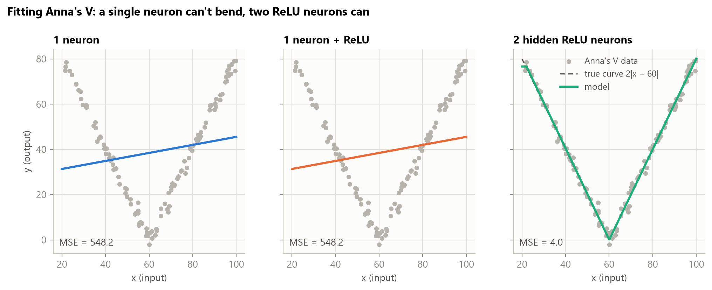
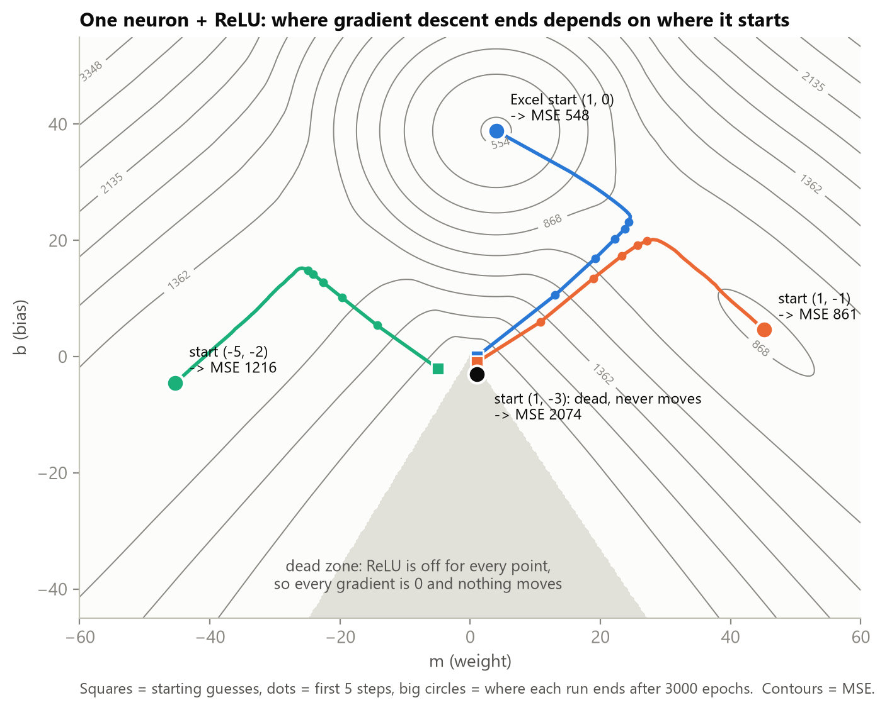
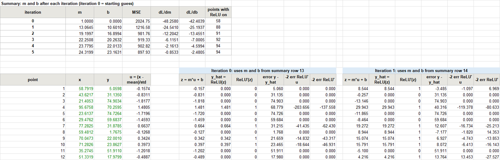
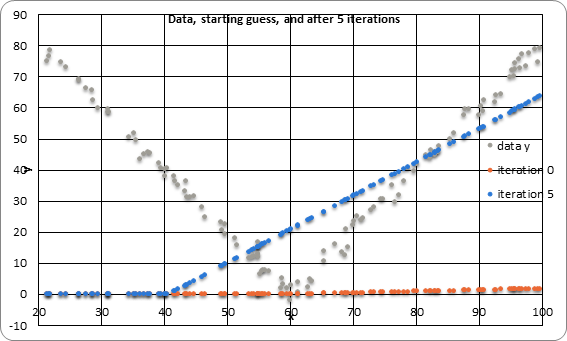
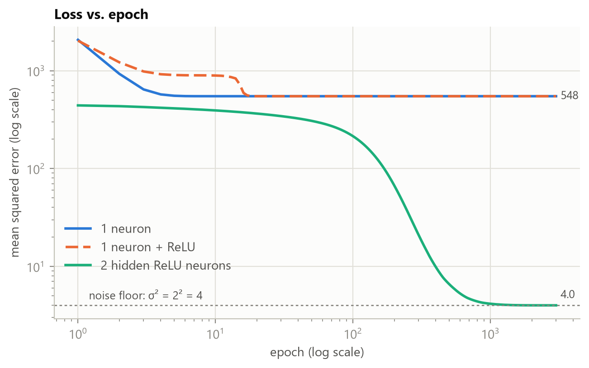
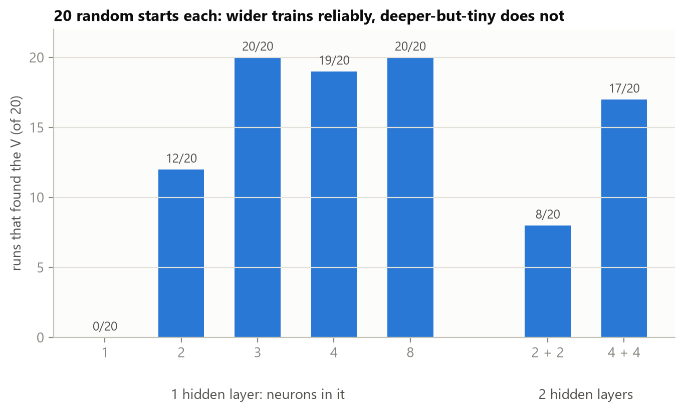

# Part 1: Fitting Anna's V with gradient descent

Before building the finger lock, I wanted to understand how a neural network finds its own weights. I took the **V** example from Anna's Code and fit it three ways: with one neuron, with one neuron plus a ReLU, and with a small network of two ReLU neurons. I did the math by hand, ran 5 iterations of gradient descent in Excel, wrote the same gradient descent in Python (numpy only), and then checked that PyTorch computes exactly the gradients I derived. The short version: **a single neuron cannot bend, so it can never make a V, but two ReLU neurons can**. Along the way, the ReLU taught me about dead neurons and about why the starting guess matters.



---

## 1. The data

In Anna's Code (builder page), under *Example data*, I picked **V** and saved it with the **Save** button ([`data/annacode-v.tsv`](data/annacode-v.tsv)). The page generates it in [`network/training.py`](https://github.com/chrisbuerginrogers/ME193-Robotics/blob/main/Public%20stuff/AnnaCode/network/training.py) as

$$
y = 2\,\lvert x - 60 \rvert + \text{noise}, \qquad \text{noise} \sim \mathcal{N}(0,\,2^2), \qquad x \in [20, 100]
$$

with $N = 120$ points. For my data set, $\bar{x} = 62.34$, $s_x = 22.52$, $\bar{y} = 38.85$ and $s_y = 23.75$.

Because the noise has a standard deviation of 2, **no model can get the mean squared error below about $2^2 = 4$**. That is the noise floor. A model that went lower would be fitting the noise.

## 2. Center and scale the input first

The class page on loss minimization showed that gradient descent blows up when $x$ is large (here $x$ runs from 20 to 100). So I first convert $x$ to a centered and scaled input:

$$
u_i = \frac{x_i - \bar{x}}{s_x}
$$

so $u$ has mean 0 and spread 1. The model learns $m$ and $b$ in terms of $u$. To get the line back in the original units, I use $m_x = m / s_x$ and $b_x = b - m\,\bar{x}/s_x$.

For a straight-line neuron, this makes the loss a perfectly round bowl. You can see it by writing the gradients in terms of the best answer ($m^\ast = \overline{yu}$, $b^\ast = \bar{y}$):

$$
\frac{\partial L}{\partial m} = 2\,(m - m^\ast), \qquad \frac{\partial L}{\partial b} = 2\,(b - b^\ast)
$$

So each step multiplies the remaining error by exactly $(1 - 2\alpha)$:

- $\alpha = 0.25$ halves it every iteration (you can see the gradients halve in the Excel table below);
- $\alpha = 0.5$ lands on the answer in one step;
- $\alpha > 1$ overshoots further every time and blows up.

## 3. The math

### 3.1 One neuron

The neuron's prediction for point $i$, and the loss (mean squared error):

$$
z_i = m\,u_i + b, \qquad L = \frac{1}{N}\sum_{i=1}^{N} \left(y_i - z_i\right)^2
$$

The gradient is how fast the loss changes when I nudge $m$ or $b$:

$$
\frac{\partial L}{\partial m} = \frac{1}{N}\sum_{i=1}^{N} -2\,(y_i - z_i)\,u_i, \qquad
\frac{\partial L}{\partial b} = \frac{1}{N}\sum_{i=1}^{N} -2\,(y_i - z_i)
$$

Gradient descent takes a small step downhill, against the gradient, with learning rate $\alpha$, and repeats:

$$
m_{\text{new}} = m_{\text{old}} - \alpha\,\frac{\partial L}{\partial m}, \qquad
b_{\text{new}} = b_{\text{old}} - \alpha\,\frac{\partial L}{\partial b}
$$

> **About the factor of 2.** The class spreadsheet and code leave out the 2 in the derivative. That only doubles the effective learning rate: their $\alpha = 0.5$ equals my $\alpha = 0.25$. I kept the 2 so my numbers are the true derivative, which also lets me check them against PyTorch later.

**Check.** After 3000 epochs, gradient descent gives $y = 0.1771\,x + 27.81$. The calculus formula from class, $m = (\overline{xy} - \bar{x}\bar{y}) / (\overline{xx} - \bar{x}^2)$ and $b = \bar{y} - m\bar{x}$, gives exactly the same line. It is almost flat, with MSE = 548. A line simply cannot follow a V.

### 3.2 One neuron with a ReLU activation

Now the output goes through a ReLU:

$$
z_i = m\,u_i + b, \qquad a_i = \operatorname{ReLU}(z_i) = \max(0, z_i), \qquad L = \frac{1}{N}\sum_{i=1}^{N} (y_i - a_i)^2
$$

The chain rule adds one more factor, the slope of the ReLU:

$$
\frac{\partial L}{\partial m} = \frac{1}{N}\sum_{i=1}^{N} \underbrace{-2\,(y_i - a_i)}_{\partial L / \partial a}\;
\underbrace{\operatorname{ReLU}'(z_i)}_{\partial a / \partial z}\; \underbrace{u_i}_{\partial z / \partial m}, \qquad
\frac{\partial L}{\partial b} = \frac{1}{N}\sum_{i=1}^{N} -2\,(y_i - a_i)\,\operatorname{ReLU}'(z_i)
$$

$$
\operatorname{ReLU}'(z) = \begin{cases} 1 & z > 0 \\ 0 & z \le 0 \end{cases}
$$

The important consequence: **a point where the neuron is "off" ($z \le 0$) contributes nothing to the gradient.** The neuron cannot learn from points it cannot see.

### 3.3 Why one neuron cannot make a V

One neuron is one line. With a ReLU it is one hinge: flat, then a ramp. Neither is a V. I expected the ReLU neuron to fit one arm of the V, but from the Excel starting point it doesn't. Predicting 0 for the whole left arm costs more than a flat line, so the neuron turns itself on for every point and ends up as **exactly the same straight line as 3.1** (MSE 548).

To see the whole picture, I computed the loss for every $(m, b)$ and ran gradient descent from four different starting guesses:



| start $(m, b)$ | ends at $(m, b)$ | MSE | what happened |
|---|---|---:|---|
| $(1, 0)$, the Excel start | $(3.99,\ 38.85)$ | 548 | ReLU on for all 120 points, so it is just the straight line (the best one neuron can do) |
| $(1, -1)$ | $(45.16,\ 4.62)$ | 861 | fits the right arm only and is stuck there |
| $(-5, -2)$ | $(-45.32,\ -4.56)$ | 1216 | fits the left arm only and is stuck there |
| $(1, -3)$ | $(1, -3)$, never moves | 2074 | **dead neuron**: off for every point, so every gradient is 0 |

The gray triangle is the **dead zone**: the region where the ReLU is off for all data. There the loss surface is perfectly flat and gradient descent cannot move. This is the "dead neuron" problem from the class notes, seen directly.

### 3.4 Two ReLU neurons: a hidden layer of width 2

To make a V, I need two hinges added together. The network is 1 input, then 2 hidden ReLU neurons, then 1 output neuron with no activation:

$$
h_{k,i} = \operatorname{ReLU}(m_k\,u_i + b_k) \quad (k = 1, 2), \qquad \hat{y}_i = w_1\,h_{1,i} + w_2\,h_{2,i} + c
$$

That gives 7 parameters. A human solution is $y = 2\,\operatorname{ReLU}(x - 60) + 2\,\operatorname{ReLU}(60 - x)$: one neuron for each arm.

**Backpropagation** is the chain rule applied layer by layer, from the output back. First, how the loss changes with each prediction:

$$
\delta_i = \frac{\partial L}{\partial \hat{y}_i} = -\frac{2}{N}\,(y_i - \hat{y}_i)
$$

The output layer's gradients come straight from it:

$$
\frac{\partial L}{\partial w_k} = \sum_i \delta_i\,h_{k,i}, \qquad \frac{\partial L}{\partial c} = \sum_i \delta_i
$$

Then the error flows back through each output weight $w_k$ and through that neuron's ReLU:

$$
\frac{\partial L}{\partial z_{k,i}} = \delta_i\; w_k\; \operatorname{ReLU}'(z_{k,i}), \qquad
\frac{\partial L}{\partial m_k} = \sum_i \frac{\partial L}{\partial z_{k,i}}\,u_i, \qquad
\frac{\partial L}{\partial b_k} = \sum_i \frac{\partial L}{\partial z_{k,i}}
$$

Every weight is then updated with the same rule, $w \leftarrow w - \alpha\,\partial L / \partial w$.

For the network, I also scale $y$ to mean 0 and spread 1, which is what Anna's code does. With raw $y$ (values up to 80), the hidden-layer gradients are multiplied by both the error and the output weights, and my first attempt blew up to `NaN`.

**Result** ($\alpha = 0.05$, 3000 epochs, random seed 1): **MSE = 4.00, right at the noise floor.** Here is what each hidden neuron learned, converted back to $x$ units:

| hidden neuron | kink at $x =$ | on for | slope it adds |
|---:|---:|:---|---:|
| 1 | 22.08 | $x > 22.08$ | $-2.02$ |
| 2 | 60.03 | $x > 60.03$ | $+4.02$ |

The network did **not** find my "one neuron per arm" solution. Neuron 1 turns on at the left edge of the data and acts as a line of slope −2 across everything. Neuron 2 switches on at $x = 60$ and adds +4, so the slope becomes −2 + 4 = +2. It is the same V, assembled differently. This is the point from the class star example: a trained network will not necessarily break a problem down the way a person would.

## 4. Excel: 5 iterations on $m$ and $b$

[`v_fit_5_iterations.xlsx`](v_fit_5_iterations.xlsx) has three sheets:

- **ReLU neuron**: one neuron plus ReLU (section 3.2).
- **Linear neuron**: one neuron, no activation (section 3.1).
- **Data**: Anna's 120 points.

Every number on the model sheets is a live formula. The blue cells (learning rate, starting $m$ and $b$) can be changed, and the whole sheet recalculates.

The class example puts each data point in a column. With 120 points, I put each point in a **row** instead, and gave each iteration a block of columns. For every point, each block has $z$, $\operatorname{ReLU}(z)$, $\operatorname{ReLU}'(z)$, the error, and the two gradient terms. The summary table at the top averages each gradient column and steps $m$ and $b$ for the next iteration.



**ReLU neuron**, $\alpha = 0.25$, start $m = 1$, $b = 0$:

| iteration | $m$ | $b$ | MSE | $\partial L/\partial m$ | $\partial L/\partial b$ | points with ReLU on |
|---:|---:|---:|---:|---:|---:|---:|
| 0 | 1.0000 | 0.0000 | 2024.75 | −48.2580 | −42.4039 | 58 |
| 1 | 13.0645 | 10.6010 | 1216.58 | −24.5410 | −25.1937 | 88 |
| 2 | 19.1997 | 16.8994 | 981.76 | −12.2042 | −13.4551 | 91 |
| 3 | 22.2508 | 20.2632 | 919.33 | −6.1151 | −7.0005 | 92 |
| 4 | 23.7795 | 22.0133 | 902.82 | −2.1613 | −4.5994 | 94 |
| 5 | 24.3199 | 23.1631 | 897.93 | | | 94 |

The last column shows the neuron switching itself on: 58 → 94 of the 120 points in 5 iterations. Its bias $b$ keeps climbing until, at epoch 14, the ReLU is on for all 120 points (see the loss plot below).

**Linear neuron**, same settings:

| iteration | $m$ | $b$ | MSE | $\partial L/\partial m$ | $\partial L/\partial b$ |
|---:|---:|---:|---:|---:|---:|
| 0 | 1.0000 | 0.0000 | 2066.54 | −5.9763 | −77.7009 |
| 1 | 2.4941 | 19.4252 | 927.82 | −2.9882 | −38.8505 |
| 2 | 3.2411 | 29.1379 | 643.14 | −1.4941 | −19.4252 |
| 3 | 3.6147 | 33.9942 | 571.97 | −0.7470 | −9.7126 |
| 4 | 3.8014 | 36.4223 | 554.18 | −0.3735 | −4.8563 |
| 5 | 3.8948 | 37.6364 | 549.73 | | |

Both gradients halve exactly at every step, as predicted in section 2 for $\alpha = 0.25$.



## 5. Python (numpy, gradient descent written by hand)

[`v_fit.py`](v_fit.py) trains all three models with plain batch gradient descent: one forward pass, the loss, the hand-derived gradients, and one update per epoch. It prints the first 5 iterations of the two single-neuron models, and those **match the Excel file to $10^{-12}$**, so the spreadsheet and the code are doing the same math.



How to read the loss plot:

- **1 neuron** (blue) drops to 548 within about 10 epochs and stays there. That is the best possible straight line.
- **1 neuron + ReLU** (orange) first plateaus near 900 while part of the data is "off". At epoch 14 the ReLU turns on for every point, and the curve falls onto the blue line.
- **2 hidden ReLU neurons** (green) creep along for about 100 epochs while the two kinks find their places, then drop by two orders of magnitude to 4.0, the noise floor.

## 6. The same network in PyTorch

The finger lock will use PyTorch, so I rebuilt the 2-neuron network there ([`v_fit_torch.py`](v_fit_torch.py)):

```python
net = nn.Sequential(nn.Linear(1, 2), nn.ReLU(), nn.Linear(2, 1))   # 1 input -> 2 ReLU neurons -> 1 output
opt = torch.optim.SGD(net.parameters(), lr=0.05)
for epoch in range(3000):
    opt.zero_grad()
    loss = nn.MSELoss()(net(u), t)    # forward pass + mean squared error
    loss.backward()                   # autograd: dL/dw for every weight
    opt.step()                        # w = w - lr * dL/dw
```

PyTorch's `loss.backward()` computes the backpropagation of section 3.4 automatically. To check that it does what I derived, I gave it the same starting weights as my numpy code and compared the gradients:

| gradient | PyTorch autograd | my hand derivation |
|---|---|---|
| $\partial L/\partial m_k$ | [0.054020, −0.068109] | [0.054020, −0.068109] |
| $\partial L/\partial b_k$ | [−0.121069, 0.152645] | [−0.121069, 0.152645] |
| $\partial L/\partial w_k$ | [−0.002538, −0.096710] | [−0.002538, −0.096710] |
| $\partial L/\partial c$ | 0.480880 | 0.480880 |

The largest difference is $1.7 \times 10^{-16}$ (floating-point round-off), and over the 3000 epochs the two loss curves never differ by more than $2.3 \times 10^{-13}$.

The script also answers the class questions (can you change the neurons, layers, activation?) from the command line: `--hidden 8`, `--layers 2`, `--act tanh`.

### Width vs. depth

Two neurons are enough *in theory*, but random starting weights don't always work out. Some runs end with a dead neuron, or with both kinks on the same side. I trained each network shape 20 times from different random starts and counted how often it found the V (final MSE < 10):



- **Width 1** never makes it. One hinge plus an output bias can only fit one arm.
- **Width 2** works 12 times out of 20.
- **Width 3 or more** is almost always reliable. The spare neurons mean that one dying or landing in a bad spot doesn't ruin the fit.
- **Depth did not help here.** Two hidden layers of 2 neurons did worse (8/20) than one layer of 2, because every tiny layer is another place where a dead neuron can block the signal. Two layers of 4 recovers to 17/20.

For a simple shape like the V, **width** is what matters. Depth pays off for problems that can be built from simpler pieces, like the class star made from triangles made from half-planes. The camera images for the finger lock will be that kind of problem.

## 7. How Anna's code does it

Anna's trainer ([`network/training.py`](https://github.com/chrisbuerginrogers/ME193-Robotics/blob/main/Public%20stuff/AnnaCode/network/training.py), `_train_epoch`) does the same thing I did, with a few safety features:

- **Same algorithm:** batch gradient descent with the backward pass written by hand. The output error is $2\,(\hat{y} - y)\,f'(z)$, it is pushed back through the weights layer by layer, it is averaged over all points, and the weights get one update per epoch.
- **Normalizes both $x$ and $y$** to mean 0 and spread 1 before training, then folds the weights back into raw units for display. That's the fix I needed in section 3.4.
- **Clips each averaged gradient to ±5**, so a bad step can't blow up the way my raw-$y$ attempt did.
- **Uses the same random start:** weights uniform in $\pm 1/\sqrt{\text{fan-in}}$, biases 0. It also checks that no two hidden neurons start identical, because they would get identical gradients and never become different.

## 8. What I learned

1. **Gradient descent is just "step downhill, repeat."** The chain rule tells you which way is downhill for every weight, and backpropagation is the chain rule applied one layer at a time.
2. **Scale your inputs.** After centering and scaling, one learning rate works for every weight, and for a line the error shrinks by exactly $(1 - 2\alpha)$ per step.
3. **ReLU's zero slope is a feature and a trap.** It lets the network bend, but a neuron that is off for every point gets no gradient and never recovers (the dead zone).
4. **One neuron can't bend, and the starting guess decides where you end up.** The same ReLU neuron ended in four different places from four starts.
5. **Width makes training reliable.** Two neurons can make the V, but three or more find it almost every time.
6. **The loss can't beat the noise.** The network bottomed out at 4.0 = $2^2$, exactly the noise Anna put into the data.

## Files

| file | what it is |
|---|---|
| [`data/annacode-v.tsv`](data/annacode-v.tsv) | Anna's V data, saved from the AnnaCode builder page |
| [`v_fit.py`](v_fit.py) | numpy gradient descent for all three models; prints the 5 iterations; makes `fit.png` and `loss.png` |
| [`relu_landscape.py`](relu_landscape.py) | loss landscape of one ReLU neuron with four gradient-descent paths |
| [`make_excel.py`](make_excel.py) | builds `v_fit_5_iterations.xlsx` (every cell is a live formula) |
| [`v_fit_torch.py`](v_fit_torch.py) | the same network in PyTorch: gradient check, training, width/depth sweep |
| [`common.py`](common.py) | loads the data, scaling, ReLU, plot style |

Run everything from this folder:

```
python v_fit.py
python relu_landscape.py
python make_excel.py              # then open the .xlsx in Excel (it calculates on open)
python v_fit_torch.py
python v_fit_torch.py --sweep     # about 3 minutes on a laptop CPU
```

Requirements: `numpy`, `matplotlib`, `openpyxl`, `torch`.
