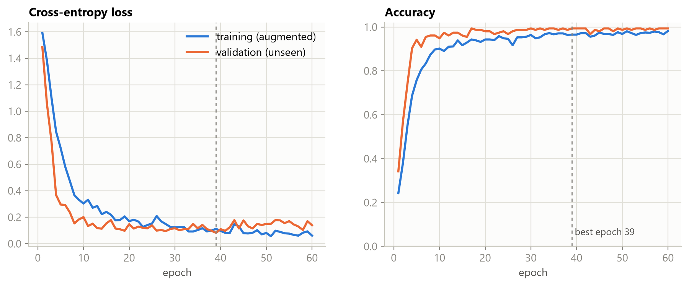
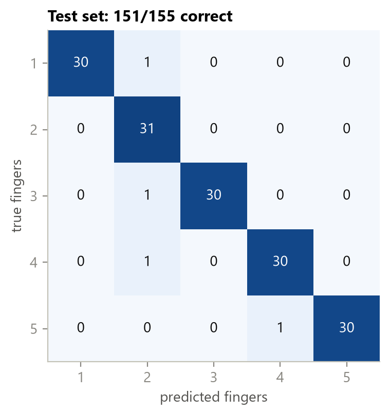
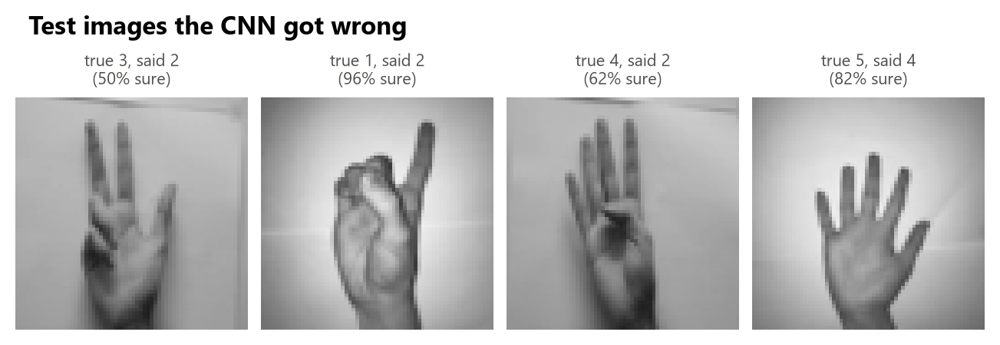

# Part 2: A small CNN that counts fingers (stand-in dataset)

The lock needs a network that looks at a camera image and says how many fingers are up (1-5). Until I have the webcam, I'm training on a public dataset of hand photos to get the PyTorch pipeline working end to end. The architecture and the training code will stay the same when I switch to my own webcam images.

## Dataset

**Sign Language Digits** by Arda Mavi ([GitHub](https://github.com/ardamavi/Sign-Language-Digits-Dataset), Apache-2.0): 100×100 color photos of hands from 218 students, digits 0-9. Digits **1-5 are made by holding up 1-5 fingers**, so I use those five folders as the five finger-count classes:

- 1 = index finger
- 2 = index + middle
- 3 = thumb + index + middle
- 4 = four fingers, thumb folded
- 5 = open hand

I skip digit 0 (an "O" shape) and digits 6-9 (different three-finger combinations).

`prepare_data.py` downloads the zip and shrinks every image to **64×64 grayscale**. It then splits each class 70/15/15:

| set | images | used for |
|---|---:|---|
| training | 722 | learning the weights |
| validation | 155 | picking the best epoch |
| test | 155 | the final score, looked at once at the end |

## The network ([`model.py`](model.py))

```
input       1 × 64 × 64
conv block  8 × 32 × 32    3×3 convolution (8 learned kernels) -> ReLU -> 2×2 max pool
conv block 16 × 16 × 16
conv block 32 ×  8 ×  8
conv block 32 ×  4 ×  4
flatten     512
dense       64 ReLU neurons, dropout 0.3
output      5 scores -> softmax -> probability of 1, 2, 3, 4, 5 fingers
```

That's **48,293 parameters**.

- **Each convolution** slides small 3×3 kernels over the image, like the Kernels page from class, except the network learns the kernel numbers itself.
- **Each max pool** keeps the strongest response in every 2×2 patch, which halves the image size.
- **The dense layers at the end** work like the neurons from Part 1.

## Training ([`train.py`](train.py))

- **Loss:** cross-entropy, the classification version of mean squared error. It penalizes the network for putting low probability on the right answer.
- **Optimizer:** Adam, learning rate 0.001, mini-batches of 32, 60 epochs. Training takes about 30 s on a laptop CPU.
- **Augmentation:** every epoch, each training image gets a random small rotation (±15°), shift, zoom, brightness change, and a 50% mirror flip. A mirrored hand still shows the same number of fingers, so the flip also covers left hands. With only 722 training images, this is what keeps the network from memorizing them.
- **Choosing the epoch:** I keep the epoch with the best validation accuracy, with ties going to the lowest validation loss.

## Results

| seed | best epoch | test accuracy |
|---:|---:|---:|
| 0 | 39 | 97.4% (151/155) |
| 1 | 38 | 99.4% (154/155) |
| 2 | 43 | 98.7% (153/155) |



Validation accuracy sits *above* training accuracy because training images are randomly distorted and dropout is on during training. The validation images are clean.





The mistakes are mostly about the thumb: a tucked or low thumb makes 3 look like 2, and 5 look like 4.

## Limitations of this stand-in data

- **Every photo is a close-up of one centered hand on a plain white wall.** A webcam frame will have a background, a different distance, and different lighting. I expect the accuracy to drop a lot on webcam images until I train on my own.
- **The same 218 people appear in training and test** (in different classes). So this tests new photos, not new people.
- **The poses are the sign-language versions** (for example, 3 includes the thumb). My lock should either use the same poses or be retrained on how I actually count.

## Run it

```
python prepare_data.py     # downloads ~17 MB, writes data/fingers_64.npz
python model.py            # prints the layer shapes and parameter count
python train.py            # trains, saves finger_cnn.pt and the figures
python train.py --epochs 100 --lr 0.0005 --seed 1   # options
```

`finger_cnn.pt` stores the weights plus the class list, image size and normalization (mean, std), which is everything needed to run the model on new images.
