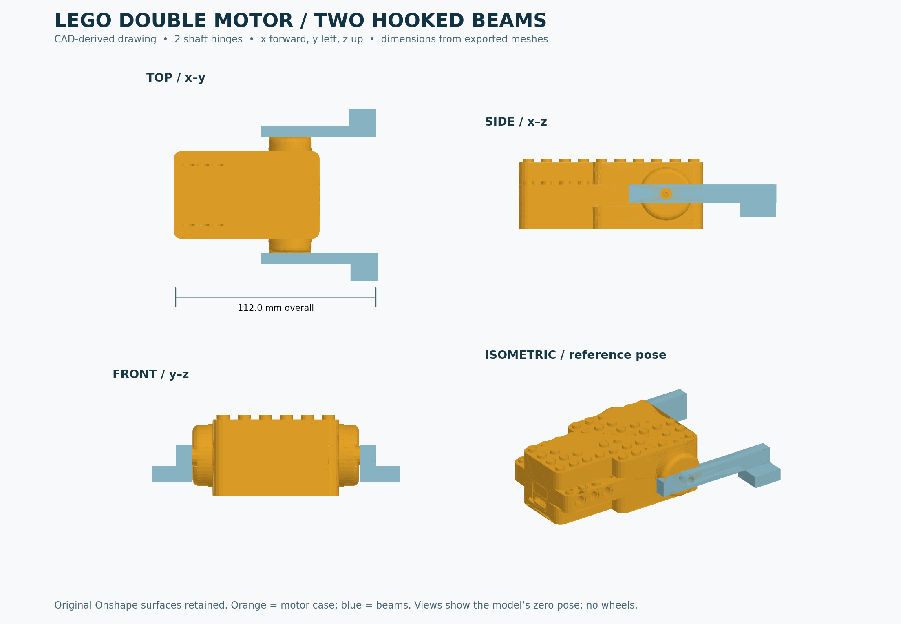
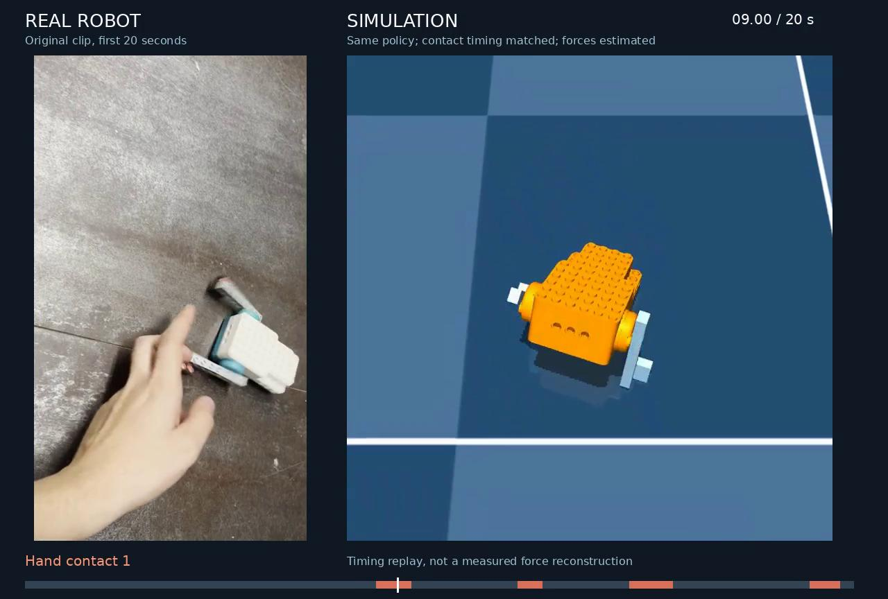
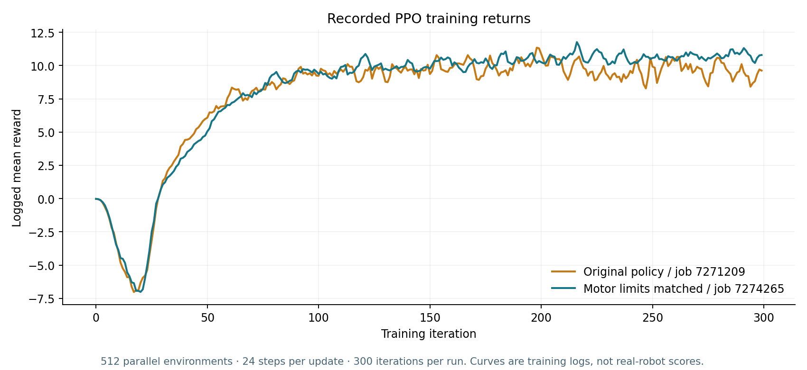

# Learning to Drive Straight with Beams Instead of Wheels

**Codrin Crismariu · ME193 Robotics · MuJoCo + MJLab + LEGO Education Double Motor**

> Can a robot move straight when its only ground-contact mechanisms are two rotating beams? This project models that robot in MuJoCo, trains a reinforcement learning policy in MJLab, and transfers the policy to a physical LEGO Double Motor over Bluetooth.

**[GitHub project](https://github.com/CodrinCrismariu/ME193-Robotics/tree/main/Codrin%27s%20Projects/MuJoCo%20LEGO)** · **[Onshape CAD assembly](https://cad.onshape.com/documents/545a624e99b20e5906c78208/w/856cbcbda4816cce8e53fd89/e/a43c0e758162b219f5a2ce7e)** · **[Watch reality vs. simulation](https://raw.githubusercontent.com/CodrinCrismariu/ME193-Robotics/main/Codrin%27s%20Projects/MuJoCo%20LEGO/media/real-vs-simulation.mp4)**

## The robot and the challenge

The hardware is a LEGO Education Double Motor 45651 with a hooked beam attached to each output shaft. There are no wheels and no separate hub. The laptop runs the trained neural network and sends independent speed commands to the two outputs. This implementation uses the LEGO hardware option rather than the Uno Q.

Rotating the beams makes the robot rock, tumble, and push against the floor. Unlike a wheel, a beam changes its contact point and leverage throughout each revolution. The two beam geometries and their attachment positions are different, so equal speed commands do not guarantee straight travel. The policy must coordinate the two outputs while the body repeatedly changes orientation.

The task is to make progress along the simulation's +x direction while limiting sideways drift, heading error, abrupt command changes, and tipping onto one shaft end.

## CAD and the MuJoCo model



*Drawing generated from the exported CAD meshes in the model's zero pose. Orange identifies the motor case; blue identifies the two beams. The real motor's color differs from this rendering.*

| Model feature | Implementation |
| --- | --- |
| CAD source | Onshape assembly, revision recorded by microversion `21546f6302184a0e68d28c2e` |
| Motor-case visual envelope | Approximately 80 × 64 × 30.4 mm |
| Beam visual envelopes | Approximately 63 × 15 × 14 mm and 64 × 15 × 14 mm |
| Motion | Two shaft hinge joints and a free-moving chassis |
| Mass assumptions | 150 g motor case; beam mass from CAD volume and ABS density, 1,050 kg/m³ |
| Total modeled mass | Approximately 159 g; a model assumption, not a scale measurement |
| Motor model | Velocity control with gain 0.05 N·m per rad/s of speed error and a 0.16 N·m torque limit |
| Physics timestep | 2 ms; the policy acts once per ten physics steps |

The raw CAD export contained separate parts without the shaft constraints and usable beam masses needed for this task. `build_beam_robot.py` adds the hinges, mass and inertia properties, and the simulation scene.

A significant modeling correction was preserving the hooked ends. An early version represented each beam with a bounding box, which filled the open space inside the hooks and changed ground contact. The corrected model retains the original visual surface and uses ten convex collision pieces per beam. Geometry tests compare the collision volumes and bounds with the CAD surfaces, and calculate beam mass from the original CAD volume.

**[CAD/model files](https://github.com/CodrinCrismariu/ME193-Robotics/tree/main/Codrin%27s%20Projects/MuJoCo%20LEGO/simulation/onshape)** · **[Model builder](https://github.com/CodrinCrismariu/ME193-Robotics/blob/main/Codrin%27s%20Projects/MuJoCo%20LEGO/simulation/build_beam_robot.py)**

## Demonstration videos



**[Watch the 20-second reality/simulation comparison](https://raw.githubusercontent.com/CodrinCrismariu/ME193-Robotics/main/Codrin%27s%20Projects/MuJoCo%20LEGO/media/real-vs-simulation.mp4)**

The left panel shows the physical robot. The right panel runs the same original policy checkpoint in the corrected model with hardware-style command limits. Both panels play at normal speed. The simulated disturbances occur during four visually identified hand-contact windows in the real video.

The replay is a qualitative comparison: contact times were estimated from the footage, and force magnitudes and directions are illustrative. They were not measured or fitted to reproduce the real trajectory. The policy controls the simulated robot freely between contacts; poses are not scripted, and automatic resets are disabled for this replay.

Additional videos:

- **[Original policy in MuJoCo — 10 seconds](https://raw.githubusercontent.com/CodrinCrismariu/ME193-Robotics/main/Codrin%27s%20Projects/MuJoCo%20LEGO/media/simulation-original.mp4)**
- **[Policy retrained with motor-command limits — 10 seconds](https://raw.githubusercontent.com/CodrinCrismariu/ME193-Robotics/main/Codrin%27s%20Projects/MuJoCo%20LEGO/media/simulation-motor-limited.mp4)**
- **[Standalone simulation of the timed disturbance replay — 20 seconds](https://raw.githubusercontent.com/CodrinCrismariu/ME193-Robotics/main/Codrin%27s%20Projects/MuJoCo%20LEGO/media/simulation-timed.mp4)**
- **[Original hardware recording](https://raw.githubusercontent.com/CodrinCrismariu/ME193-Robotics/main/Codrin%27s%20Projects/MuJoCo%20LEGO/media/real-robot-original.mov)**

## What the policy observes and controls

The actor receives only signals that can be obtained from the physical motor. It does not receive ground-truth robot position or world velocity.

| Observation | Values per frame | Purpose |
| --- | ---: | --- |
| Three-axis gyroscope | 3 | Sense body rotation |
| Three-axis accelerometer, in g | 3 | Sense tilt and contact impacts |
| Heading: sine and cosine | 2 | Measure direction relative to the starting heading |
| Both encoder angles: sine and cosine | 4 | Identify each beam's rotational phase without an angle-wrap discontinuity |
| Both encoder velocities | 2 | Estimate how fast the beams move |
| Previous applied motor commands | 2 | Relate the current motion to the last action |
| **Total** | **16** | **Ten frames produce 160 actor inputs** |

The ten-frame history spans roughly 200 ms at 50 Hz. Each observation term's history is stored oldest first before the terms are concatenated. This gives the network information about motion over time despite delayed and noisy sensor readings.

The actor is a feed-forward neural network with two 128-unit hidden layers and ELU activations. Its two outputs request left and right beam velocities. A separate critic uses 22 values of privileged simulation information to estimate expected return during training. The critic is not deployed on the LEGO robot.

Heading is defined from the **shaft direction**, rather than a body-forward axis that flips during tumbling. In deployment, the heading signal must be referenced to the intended direction at startup; axis conventions and firmware yaw behavior remain part of the calibration challenge.

## How training works

The workflow connects CAD, simulation, learning, and hardware:

```text
Onshape assembly → exported meshes → MuJoCo beam robot
                                      ↓
                           512 parallel MJLab environments
                                      ↓
                             PPO actor/critic training
                                      ↓
                          checkpoint → normalized ONNX actor
                                      ↓
                      Windows sensor loop → Bluetooth → LEGO
```

Ubuntu WSL manages the files and submits jobs to Tufts' HPC cluster. GPU training runs on the cluster, rather than inside WSL. MuJoCo provides the contact dynamics; MJLab organizes the environment, observations, actions, rewards, resets, and GPU simulation. PPO, through RSL-RL, updates the actor and critic from the collected experience. [MJLab](https://github.com/mujocolab/mjlab), [MuJoCo](https://mujoco.readthedocs.io/en/stable/overview.html).

For each update, 512 simulated robots each collect 24 control steps. The critic helps estimate which actions led to better outcomes; PPO then updates the networks while limiting how much the policy changes at once. Repeating this for 300 iterations produces **3,686,400 environment transitions** per training run.

| Training setting | Value |
| --- | --- |
| Task | `Beam-Drive-Straight` |
| Algorithm | PPO with separate actor and critic |
| Parallel robots | 512 |
| Iterations | 300 for the recorded runs |
| Steps per robot per update | 24 |
| Learning epochs / minibatches | 5 / 4 |
| Initial learning rate | 0.001, with adaptive scheduling |
| PPO clipping parameter | 0.2 |
| Discount factor / GAE lambda | 0.99 / 0.95 |
| Entropy coefficient | 0.005 |
| Episode length | Up to 10 seconds, or 500 control steps |

Episodes begin with heading errors up to ±45°. An episode ends when time expires, the robot moves more than 0.5 m off the line, or the shaft becomes too vertical to continue driving (`|shaft_z| > 0.8`).

### Reward system

Forward progress is the only positive reward term. The remaining terms discourage behaviors that make that progress unreliable.

| Term | Weighted contribution before timestep scaling | Intended behavior |
| --- | --- | --- |
| Forward speed | `2 × clip(average_forward_speed / 0.2, -1, 1)` | Move forward toward a 0.2 m/s target |
| Stay on line | `-0.25 × (sideways_offset / 0.2)²` | Limit lateral drift |
| Face forward | `-0.5 × heading_error²` | Correct direction; angle measured in radians |
| Action rate | `-0.02 × sum((action - previous_action)²)` | Avoid abrupt changes in motor commands |
| Keep shaft level | `-2 × shaft_vertical_component²` | Avoid standing on one end |
| Termination penalty | `-25 × terminated_indicator` | Discourage failures that end the episode |

MJLab scales the weighted reward sum by the 0.02-second control timestep. For example, a single terminal penalty contributes approximately −0.5. Forward speed uses an approximately half-second moving average because instantaneous velocity rises and falls sharply during each tumble. This rewards sustained progress instead of penalizing the unavoidable slow part of each revolution.

The sideways penalty is deliberately modest: the actor can sense heading, but it cannot directly measure its lateral position. The code comments also record an unsuccessful reward design: a flat survival bonus made standing still profitable. Removing that bonus aligned reward with movement.

### Training for an imperfect physical robot

Training varies motor mass, beam mass, motor gain, torque limits, and floor friction. It also adds encoder quantization, IMU noise and bias, heading drift, and disturbances. Motor mass varies by ±20%, beam mass by ±10%, and the motor's centre of mass can shift by up to 5 mm. The modeled command delay is 30–120 ms; sensor delay is 20–80 ms.

Random pushes last 0.05–0.2 seconds and recur after 1–3 seconds. These variations make the policy practice on a family of imperfect robots rather than relying on one exact simulator configuration. The ranges are modeling assumptions; the short hardware probes did not identify every physical parameter.

## Results



Two recorded runs use the corrected hooked-beam geometry. The second includes the physical adapter's per-output saturation and whole-percent command rounding.

| Recorded result | Original policy | Motor-limited retraining |
| --- | ---: | ---: |
| Training job | 7271209 | 7274265 |
| Final logged mean reward | 9.62 | 10.79 |
| Mean episode length at final update | 471.77 / 500 steps | 491.10 / 500 steps |
| Forward distance in the saved 10-second evaluation | 1.94 m | 1.26 m |
| Final lateral offset in that evaluation | −0.08 m | −0.04 m |
| Final heading in that evaluation | +8.7° | −6.9° |

These evaluation numbers come from one saved rollout per policy with the task's noisy observations and disturbances. They are not averages over repeated trials, and the final offset does not describe the entire path. The later policy's higher training return and smaller final error in this rollout do not establish that it is universally better. The changed command limits also make speed comparisons configuration-dependent.

The root `policy.onnx`, the hardware deployment, and the timed real/simulation comparison use the **original** `train-20261116-193502/model_299.pt` policy. The motor-limited retraining is preserved separately under `experiments/motor-limited/`; it has not replaced the deployed ONNX model.

## Bringing the simulation to the LEGO robot

The physical adapter connects to the Double Motor on orange connection card `0999`. The exported ONNX actor includes its learned observation normalizer. Each control cycle reads fresh sensor data, converts units and axes, constructs the same 160-value history, runs inference, and converts the two outputs into LEGO speed percentages.

Short automatic probes established encoder direction and provided provisional speed estimates. The recorded 90° yaw turn supported gyro units of degrees per second and yaw units of tenths of a degree. Comparing motor-probe responses against alternative MuJoCo frame conventions gave the same best axis/sign candidate in two probe sets, but the fit margins were modest. The configuration therefore remains explicitly marked as an automatic estimate.

This exposed a mismatch in the original training setup: multiplying a Gaussian policy output by 21 rad/s did not impose a maximum speed. The physical SDK accepts bounded percentage commands. The later training task matches the adapter by saturating and rounding each motor command and feeding the applied command back into the observation history. The current estimates imply command ceilings of 16.494 rad/s left and 14.076 rad/s right.

Those ceilings are extrapolations from low-speed pulses, not measurements of the motors' true maximum speed. For comparison, LEGO specifies 322–346 rpm unloaded and 192–220 rpm under a 50 mN·m load at 4.2 V. [LEGO product specification](https://static.prod01.ue1.p.pcomm.net/legoedu/content/classroomandteacherresources/Science_Tech%20Spec%20Sheet_Digital_1HY25_ENUS.pdf).

### How close are simulation and reality?

Both the physical robot and the simulation show beam-driven movement and changes in orientation, and the exported actor ran on real sensor feedback. The side-by-side video makes the differences in contact, turning, and disturbance response visible.

The logged three-second hardware trial, capped at 20% speed, ended with approximately **28° of reported heading change**. A follow-up sensor read confirmed that both motors stopped. That trial demonstrates deployment, but does not demonstrate accurate straight driving. The later hardware recording provides additional visual evidence; it does not supply a measured real-world distance, speed, or cross-track error.

The most important remaining gaps are contact friction, motor behavior under load, estimated sensor-axis/encoder alignment, heading during tumbling, and communication timing. The SDK also emitted pending-command warnings during disconnect after overlapping timed commands. The comparison replay cannot close those gaps by itself because its external forces were estimated.

## Engineering lessons and next steps

**Contact geometry matters as much as appearance.** Filling in a hook with a collision box changes how the robot pushes against the floor. The visual model and contact model both need to preserve the features that generate motion.

**The reward must make the intended behavior worthwhile.** A survival bonus can teach a robot to remain still. Rewarding averaged forward progress, while penalizing drift and falls, gives the policy a reason to move despite the uneven motion of tumbling.

**The deployed action interface is part of the model.** Sensor units, axis directions, speed saturation, percentage rounding, and latency can change the policy's behavior even when its neural-network weights are identical.

The next useful test is a repeated, measured hardware evaluation: record distance travelled, maximum cross-track error, heading error, and failures over the same duration on the same surface. Full-speed measurements under load and a better-matched encoder-speed estimator would improve the simulator before longer retraining. Multiple simulation seeds and repeated hardware trials would then allow a stronger comparison than a single demonstration video.

## Project files

**[Source code and reproduction commands](https://github.com/CodrinCrismariu/ME193-Robotics/blob/main/Codrin%27s%20Projects/MuJoCo%20LEGO/README.md)** · **[Current training task and rewards](https://github.com/CodrinCrismariu/ME193-Robotics/blob/main/Codrin%27s%20Projects/MuJoCo%20LEGO/simulation/mjlab_task/beam_task.py)** · **[Preserved runs, checkpoints, and logs](https://github.com/CodrinCrismariu/ME193-Robotics/tree/main/Codrin%27s%20Projects/MuJoCo%20LEGO/experiments)** · **[Calibration evidence](https://github.com/CodrinCrismariu/ME193-Robotics/tree/main/Codrin%27s%20Projects/MuJoCo%20LEGO/calibration)**

The package includes the CAD meshes, generated MJCF, training and video scripts, both policy checkpoints, deployment code, recorded media, and source hashes. Private Onshape API credentials and local virtual environments are excluded.
