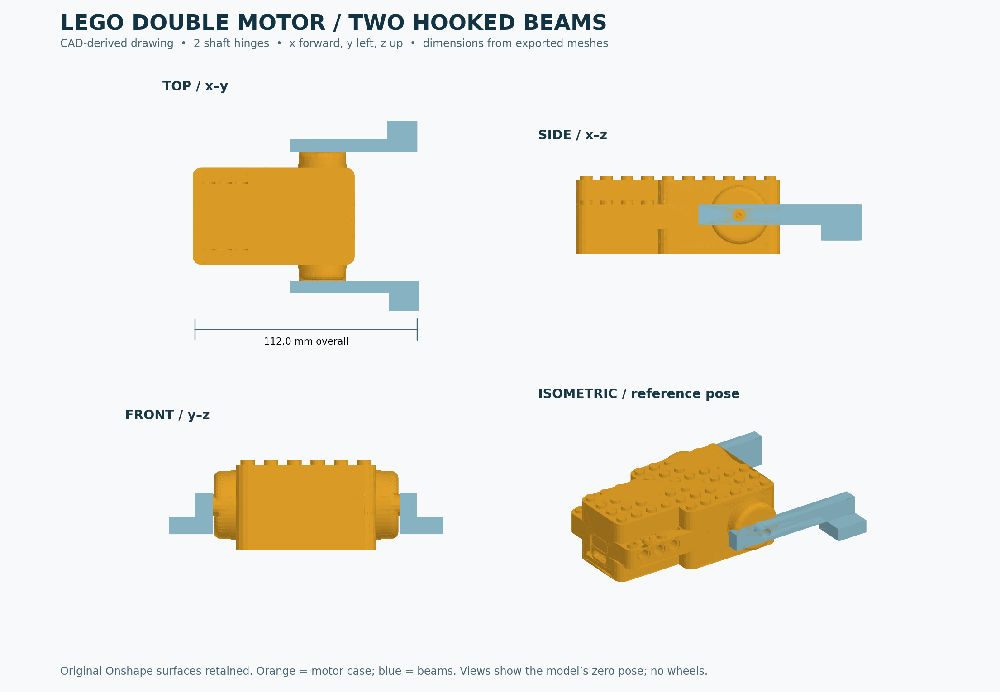

# LEGO beam robot — MuJoCo, MJLab, and physical deployment

Two hooked beams replace wheels on one LEGO Education Double Motor. MJLab trains a PPO policy to coordinate the two output shafts and drive straight through repeated beam/floor contacts.

**[Full project presentation / Notion-ready Markdown](PROJECT_NOTION.md)**



**[Real robot vs. simulation](media/real-vs-simulation.mp4)** · **[Original-policy simulation](media/simulation-original.mp4)** · **[Motor-limited retraining](media/simulation-motor-limited.mp4)**

## Files

| Path | Contents |
| --- | --- |
| `PROJECT_NOTION.md` | Presentation with CAD, videos, policy, reward, training results, and limitations |
| `simulation/` | Current WSL model builder, original CAD meshes, generated MJCF, and MJLab tasks |
| `experiments/original/` | Original task, checkpoint, training/evaluation logs, and parameters |
| `experiments/motor-limited/` | Later task and checkpoint with adapter-matched speed saturation/rounding |
| `experiments/hand-disturbance-replay/` | Replay schedule, input hashes, and simulation telemetry |
| Root Python files | Windows LEGO connection, ONNX inference, export, and calibration helpers |
| `policy.onnx`, `policy.json` | Export of the **original** checkpoint; includes actor observation normalization |
| `media/` | CAD drawing, training plot, simulation videos, real recording, and comparison video |
| `hpc/` | WSL job submission helpers; private `config.sh` is excluded |
| `SOURCE_MANIFEST.json` | Import provenance and SHA-256 hashes |

The sources were pulled from Ubuntu-24.04's `/home/useru/mujoco-hpc` on November 17, 2026. The working Windows deployment was collected alongside them. Two different policy versions are intentionally preserved. The later motor-limited checkpoint is **not** the model in root `policy.onnx`.

## Training and video generation

Use an NVIDIA GPU environment compatible with the recorded stack: Python 3.13, MJLab 1.6.0, PyTorch 2.11.0+cu128, and Warp 1.14.0. These versions are recorded in the training logs; install PyTorch for the compute node's CUDA driver. The existing cluster environment is `~/mujoco-env`. Additional video/export packages are `imageio`, `imageio-ffmpeg`, `Pillow`, and `onnx`.

From this project directory inside WSL, copy `hpc/config.example.sh` to `hpc/config.sh` and enter your own cluster settings. `hpc/runIt.py` stages files by basename, submits a Slurm job, and retrieves results under `hpc/runs/`. The cluster environment must already be installed and activated by the generated job template.

```bash
# Train the current, motor-limited task from scratch.
python3 hpc/runIt.py --gpu --time 00:15:00 --mem 16G --cpus 4 --no-open \
  --with simulation/mjlab_task/beam_task.py --with simulation/onshape \
  simulation/mjlab_task/train.py Beam-Drive-Straight \
  --env.scene.num-envs 512 --agent.max-iterations 300

# Reproduce a video with the saved later checkpoint and matching task.
python3 hpc/runIt.py --gpu --time 00:10:00 --mem 16G --cpus 4 --no-open \
  --with experiments/motor-limited/beam_task.py --with simulation/onshape \
  --with experiments/motor-limited/model_299.pt \
  simulation/mjlab_task/make_video.py model_299.pt Beam-Drive-Straight

# For the original policy video, change both experiment paths above to experiments/original/.
```

Rebuild the CAD-derived model locally only when required:

```bash
python -m pip install -r simulation/requirements-build.txt
python simulation/build_beam_robot.py
python -m unittest discover -s simulation -p 'test_beam_geometry.py' -v
```

The exported CAD meshes are already included, so an Onshape connection is not needed to train. `simulation/onshape/config.json` identifies the source assembly. Refreshing it separately requires onshape-to-robot and private API credentials, using `simulation/.env.example` as a template.

For a direct GPU-node run from the project directory, use:

```bash
python simulation/mjlab_task/train.py Beam-Drive-Straight --env.scene.num-envs 512 --agent.max-iterations 300
```

## Physical robot

Run Bluetooth on Windows. From this directory in PowerShell:

```powershell
py -3.12 -m venv .venv
.\.venv\Scripts\python.exe -m pip install -r requirements.txt
.\.venv\Scripts\python.exe run.py check
.\.venv\Scripts\python.exe run.py policy --model policy.onnx --seconds 5 --allow-estimated
# Send motor commands explicitly:
.\.venv\Scripts\python.exe run.py policy --model policy.onnx --seconds 5 --allow-estimated --move
```

The saved configuration targets **orange 0999**, uses the full 100% SDK command range, and remains an **automatic calibration estimate**. The five-second calibration restriction was removed at the user's request; `--seconds` controls the requested duration. The saved measurements do not establish a valid full-speed motor curve. Ctrl+C stops the loop; stale telemetry, disconnection, and a large control deadline miss also abort. Commands have a 200 ms device-side duration and cleanup issues an explicit stop.

The initial physical trial was performed at a 20% cap and showed heading drift. The current unrestricted command configuration must not be confused with that measured trial. See [calibration/RESULTS.md](calibration/RESULTS.md) for evidence and the SDK's pending-command disconnect warnings.

```powershell
.\.venv\Scripts\python.exe -m unittest -v
```

This tests the adapter without connecting to hardware. CAD geometry tests require MuJoCo/trimesh. `simulation/mjlab_task/test_motor_limits.py` requires the matching MJLab GPU environment.

## Export and comparison

Use `export_policy.py` in the same training environment, with `--task-dir` pointing to the checkpoint's matching task directory and CAD available one folder above it, or stage the task and `onshape/` next to the exporter through `hpc/runIt.py`. Export the later policy to a **new output directory** so its model is not mistaken for the preserved original.

The recorded hand-contact replay uses the original checkpoint with the current command-limited environment. This is intentional, to match the physical adapter's interface. It is not the later retrained policy. To regenerate, stage `simulation/mjlab_task/replay_hand_disturbances.py`, the current `beam_task.py`, `simulation/onshape/`, the original checkpoint, and `experiments/hand-disturbance-replay/hand_schedule.json` together on the GPU node. Run `python replay_hand_disturbances.py model_299.pt hand_schedule.json`.

```bash
python simulation/mjlab_task/compose_hand_comparison.py \
  media/real-robot-original.mov /path/to/generated/simulation.mp4 \
  experiments/hand-disturbance-replay/hand_schedule.json /path/to/output
```

The compositor uses the Linux DejaVu Sans font path. Contact times and policy startup time are estimates; forces are illustrative and not measured. Automatic resets and unrelated random pushes are disabled for the comparison. See its [manifest](experiments/hand-disturbance-replay/manifest.json).

Generate the presentation figures using `make_project_figures.py` with NumPy, matplotlib, and trimesh installed. It uses the actual CAD meshes and archived logs; it does not invent geometry or training results.

## Attribution

The HPC helpers and wheeled-task support originate from the ME193 shared MuJoCo/HPC material. This project adds the double-motor beam model, beam task, hardware adapter, calibration work, and experiment presentation. Dependencies retain their own licenses: [MuJoCo](https://github.com/google-deepmind/mujoco), [MJLab](https://github.com/mujocolab/mjlab), [RSL-RL](https://github.com/leggedrobotics/rsl_rl), and [LEGO Education Python](https://github.com/LEGO/LEGOEducation).
